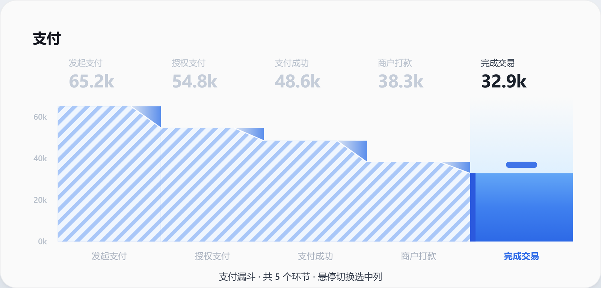
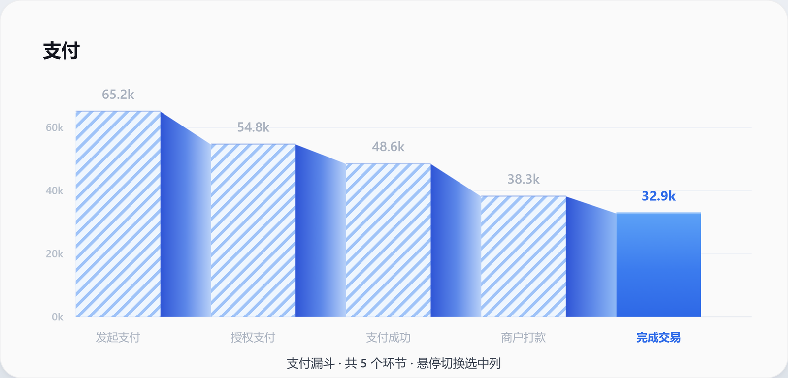
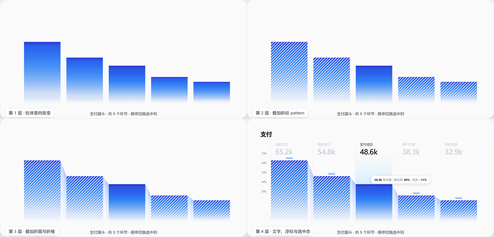
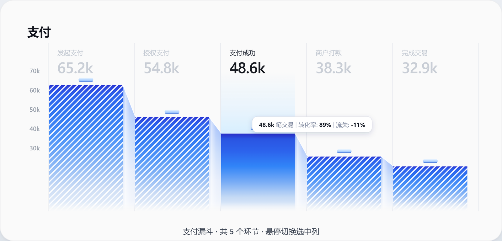
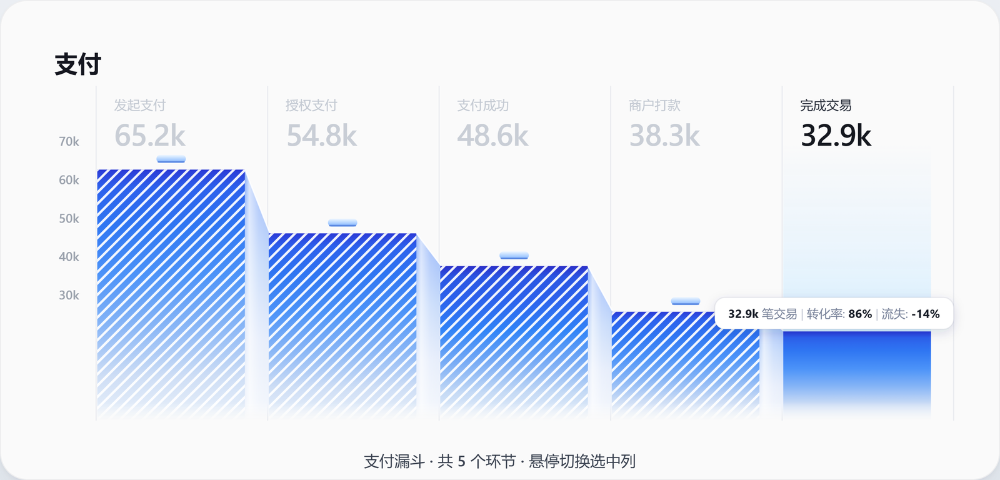

# 把柱状图折成一张纸：手写 SVG 复刻折纸风漏斗图

先看最终效果。鼠标划过五根柱子，选中的那根会从一片斜纹里"翻"出来，气泡换到那一列顶上：


事情起因很简单。看到一张设计稿，柱状图做成折纸的样子：柱子之间不是空隙，而是纸折过去的斜面；柱体不是纯色，是横线笔记本纸那种斜纹；整张纸往下逐渐淡出，落在卡片上没有硬底线。

这种图用 ECharts 或 AntV 做，我得先跟它们的 series 抽象搏斗半天，最后还是得回到自定义图形。既然横竖都要自己画多边形，不如直接写 SVG。整个文件 612 行，零依赖，浏览器打开就能跑。

代价也很明确：图例、坐标轴自适应、响应式、主题、无障碍这些图表库白送的东西，全得自己写或者干脆不要。这里就五根柱子、一组写死的数据，我觉得这笔账划得来。

## 一个页面里放三个方案

第一版做完我对着参考图看了很久，总觉得哪里不对，但说不上来。于是我让 AI 把同一个数据源画三个不同折法的版本，塞进同一个页面的三个 tab 里，来回切着看。


三个方案来回切的过程：


对比本身只花了两分钟，结论很清楚：

效果 1 把折面做成了柱顶的一个小三角，斜纹用不透明的浅蓝底，整根柱子像贴了蓝白条纹胶带，塑料味最重。



效果 2 改成直立斜切的整块折面，加了横向明暗渐变（折角深、外缘亮）。折痕是锐了，可那道横向渐变让每个斜面都像一块抛光的金属板，还是不像纸。



真正的问题在效果 3 里才看明白：参考图的折面是竖向渐变的，靠折痕那一段最亮，往下迅速淡到和卡片背景一个颜色。纸薄，折过去之后下半截本来就隐进桌面的阴影里。效果 3 把折面改成"上亮下淡、最后化进背景"，那层塑料感一下就没了。

改动其实就一个渐变方向。前两版一直在折面的形状和横向明暗上打转，方向错了。

三个方案共用一份数据，改一次数字三处同时变：

```js
const DATA = [
  { label:'发起支付', value:65.2 },
  { label:'授权支付', value:54.8 },
  { label:'支付成功', value:48.6 },
  { label:'商户打款', value:38.3 },
  { label:'完成交易', value:32.9 },
];
```

顺带说下那个 tab 容器，两个小坑。

滑动指示条用的是一个绝对定位的 `.glider`，靠 `transform: translateX(i * 100%)` 移动，宽度是 `calc((100% - 10px) / 3)`。文字颜色切换加了 60ms 延迟，让滑块先动、文字后变白，比同时变要顺眼。

三个面板最初高度不一致，直接 `display: none` 切换会把下面的内容猛地拽上去。所以切换时给 `.stage` 做了一次高度过渡：

```js
const h0 = stage.offsetHeight;
prev.classList.remove('show');
next.style.setProperty('--from', 46 * dir + 'px');
next.classList.add('show');
const h1 = next.offsetHeight;
if (h0 !== h1) {
  stage.style.height = h0 + 'px';
  requestAnimationFrame(() => { stage.style.height = h1 + 'px'; });
  stage.addEventListener('transitionend', function te(e) {
    if (e.target !== stage) return;
    stage.removeEventListener('transitionend', te);
    if (token === animToken) stage.style.height = '';
  });
}
```

`animToken` 是快速连点留下的坑：上一次过渡的 `transitionend` 会在切换之后才到，那时候高度已经被新一次切换接管了，旧回调会把新的高度内联样式清空，面板跳一下。用自增的 token 比一下就能确认这个回调还是不是当前这次切换的。

不过这段现在跑不到了。后来把三个面板对齐成同一个 `viewBox="0 0 860 386"`、同一套 `.board` 卡片，内边距、圆角、阴影和底部那行 caption 全部一致，`h0 !== h1` 恒为假，`if` 里面成了死代码。要么删掉，要么等哪天面板重新不等高再启用。

## 一根柱子是四层叠出来的

拆开看最直观。从左到右是叠加顺序：



第一层是柱体本身的竖向渐变，七个 color stop，从顶上的深蓝 `#2B3AD6` 一路淡到接近白的 `#EBF2FA`。

第二层是斜纹，盖在渐变上面。

第三层是折面，每两根柱子之间一块。

第四层是文字、柱顶的小浮标、选中列的浅蓝衬底和气泡。

代码里就是一根柱子一个 `<g class="col">`，按这个顺序往里 append，最后压一个透明的 `.hit` 矩形当热区：

```js
g.appendChild(el('rect', { class:'wash',    x, y:WASH_TOP, width:BAR_W, height:y - WASH_TOP, fill:'url(#wash)' }));
g.appendChild(el('rect', { x, y, width:BAR_W, height:PLOT.bottom - y, fill:'url(#bar'+i+')' }));
g.appendChild(el('rect', { class:'stripes', x, y, width:BAR_W, height:PLOT.bottom - y, fill:'url(#stripes)' }));
// 折面
g.appendChild(el('rect', { class:'hit', x:PLOT.left + i * COL_W, y:PLOT.top, width:COL_W, height:PLOT.bottom - PLOT.top }));
```

顺序即层级，SVG 没有 z-index。

## 折面：一个四边形加两次渐变

折面这块只有四行代码：

```js
const nx = barX(i + 1), ny = barTop(i + 1);
const flap = `${x + BAR_W},${y} ${nx + 1},${ny} ${nx + 1},${PLOT.bottom} ${x + BAR_W},${PLOT.bottom}`;
g.appendChild(el('polygon', { points:flap, fill:'url(#fold'+i+')' }));
g.appendChild(el('polygon', { points:flap, fill:'url(#crease)' }));
g.appendChild(el('line', { x1:x + BAR_W, y1:y, x2:nx + 1, y2:ny, stroke:'rgba(255,255,255,.85)', 'stroke-width':1.2 }));
```

同一个四边形填了两遍。第一遍是纸本身的颜色，竖向，折痕处 `#8FB2F8`，往下到 `#F4F7FC` 基本和卡片背景一个色。第二遍是一条横向的白色高光，透明度从 0 到 62% 再回 0，模拟光打在那道棱上。两遍都半透明，叠起来既有纸的颜色，又有一道反光。

第三行那条 1.2px 的白线是折棱本身，`rgba(255,255,255,.85)`。有它和没它的区别，是"两块色块挨着"和"纸在这里折了一道"。


这里有个不写就必踩的点：折面的渐变必须声明 `gradientUnits="userSpaceOnUse"`。

```js
const g = el('linearGradient', {
  id:'fold' + i, gradientUnits:'userSpaceOnUse',
  x1:0, y1:y0, x2:0, y2:PLOT.bottom
});
```

SVG 渐变的默认值是 `objectBoundingBox`，坐标系会缩放去贴合当前图形的包围盒。折面是个梯形，每根柱子的梯形高度都不一样，用默认值的话"折痕处最亮"就变成了"每根柱子的折面自己从顶亮到底"，五块折面的明暗节奏完全不连续。改成 `userSpaceOnUse` 之后，渐变按 SVG 的真实坐标算，`y1` 直接写死成这一列柱顶的 y，五块折面才像同一张纸上的连续受光。

同样的坑在柱体渐变上没有，因为它本来就是每根柱子一个 `id`、从自己的柱顶算到自己的柱底，包围盒坐标系刚好合适。

## 斜纹：一个 pattern 铺满五根柱子

斜纹是 `pattern` 画的，一个 7.1 × 7.1 的格子转 45 度，格子里一条 2.1 宽的白线：

```js
const pat = el('pattern', {
  id:'stripes', width:7.1, height:7.1,
  patternUnits:'userSpaceOnUse', patternTransform:'rotate(45)'
});
pat.appendChild(el('rect', { x:0, y:0, width:7.1, height:7.1, fill:'none' }));
pat.appendChild(el('rect', { x:0, y:0, width:2.1, height:7.1, fill:'#fff', 'fill-opacity':.93 }));
```

两个细节。

一个是 `patternUnits:'userSpaceOnUse'`。这意味着平铺的起点是 SVG 坐标系，不是每根柱子各自的左上角。五根柱子共用一个 pattern，斜纹在整个画布上连续排下来，跨过柱子之间的缝隙也不接错。要是默认的 `objectBoundingBox`，每根柱子内部的条纹密度会随柱宽变化，一眼就能看出是五块布拼的。

另一个是白线只有 93% 不透明度，底下没填色。斜纹是叠在蓝色渐变上的白色条纹，不是蓝白相间的实色条纹。所以选中某一列时，把 `.stripes` 的 `opacity` 设成 0，下面纯粹的渐变柱体就露出来了，不需要换任何颜色：

```css
.stripes { opacity:1; transition:opacity .32s ease }
.col.active .stripes { opacity:0 }
```

## 高度映射用了平方，坐标轴没跟

参考图里最短那根柱子明显比数值比例看起来矮得多，漏斗的轮廓是靠这个落差撑起来的。所以柱顶坐标不是线性映射：

```js
const topOf = v => STAIR.base - Math.pow(v / MAX, 2) * (STAIR.base - STAIR.top);
```

`MAX` 是 65.2，`STAIR` 是 `{ base:330, top:138 }`。平方之后，65.2k 那根柱高 222px，32.9k 那根只有 79px。要是线性映射，同样这两个数会是 222 和 127，落差从接近三倍掉到一点八倍，漏斗就不像漏斗了。

这件事没有技术含量，纯粹是"看着不对，试试平方"。平方、1.5 次方还是直接手调每根柱子的高度，都是同一类操作。我倾向于平方，因为它至少在单调这一点上是诚实的。

但代价是左边那组刻度失效了。`AXIS_Y` 是手写的五个数，等距 34px 一档，是线性轴：

```js
const AXIS = [70,60,50,40,30];
const AXIS_Y = [113,147,181,215,249];
```

柱高走平方、刻度走线性，两套映射不通用。32.9k 的柱顶在 y=281，按左边的轴读出来只有 20k 出头，差了四十多个像素。这张图不能拿尺子量。要较真的话，把 `AXIS_Y` 也过一遍 `topOf` 就对齐了，但那样柱子的相对高度就退回线性，落差又不够看了。我最后选了保留轮廓、牺牲刻度，反正这五根柱子旁边就写着 65.2k 48.6k 这些真实数字，没人会去量像素。

如果要拿这张图做数据分析，平方映射得去掉。

## 纸的下沿是渐隐的，不是切齐的

柱子底部没有画基线，纸是自己淡出去的：

```js
const maskG = el('mask', { id:'fade', maskUnits:'userSpaceOnUse', x:0, y:0, width:860, height:386 });
const fadeG = el('linearGradient', { id:'fadeGrad', gradientUnits:'userSpaceOnUse', x1:0, y1:344, x2:0, y2:360 });
[[0,'#fff'],[1,'#000']].forEach(([o,c]) => fadeG.appendChild(el('stop',{offset:o,'stop-color':c})));
maskG.appendChild(el('rect', { x:0, y:0, width:860, height:386, fill:'url(#fadeGrad)' }));
```

`mask` 里白色不透明、黑色透明，所以 y=344 以上全显、往下 16px 内线性淡到 0。整个柱子图层套上这个蒙版：

```js
const layer = el('g', { mask:'url(#fade)' });
```

用 mask 而不是给每根柱子叠一层背景色的渐变矩形，是因为叠色块会盖住折面和斜纹，颜色还得跟卡片背景手动保持一致。卡片背景以后改成深色，mask 方案一行不用动。

## 交互全在 CSS 里，JS 只加一个类

选中一列要同时变六件事：斜纹消失、浅蓝衬底出现、标签文字变黑、数字变黑、气泡换列、柱顶浮标提亮。

一行 JS 都没有，只有：

```js
function setActive(i) {
  if (i === active) return;
  active = i;
  cols.forEach(c => c.classList.toggle('active', +c.dataset.i === i));
  renderTip(i);
}
```

剩下的都是 CSS 的 `transition`：

```css
.lbl { fill:var(--dim); transition:fill .3s ease }
.col.active .lbl { fill:#242A36 }
.wash { opacity:0; transition:opacity .32s ease }
.col.active .wash { opacity:1 }
```

这个分工是我这次最想强调的一条。JS 里写动画，就得自己处理中断、缓动、每一帧的插值；换成"改一个 class，CSS 负责所有过渡"，鼠标在同一列里来回抖、快速划过五列，浏览器都会自然地把过渡打断并从中途接着走。这类时序问题用 JS 写几乎一定会漏。

热区是每根柱子上那个透明的 `.hit`，宽度是整个列宽 `COL_W`（151.6），不是柱子的 130.6。也就是说鼠标落在柱子和折面所在的整格里都算选中这一列，不用瞄准。

`if (i === active) return;` 这个幂等判断看着多余，实际上不加的话，鼠标在格子内部小幅移动会反复触发 `renderTip`，而 `renderTip` 里有 `getComputedTextLength()` 这种强制布局的调用，抖起来很费。

移出图表时不回到"无选中"，而是固定回到第三列：

```js
layer.addEventListener('mouseleave', () => setActive(2));
```

因为这张图默认态就得有一列是亮的，否则斜纹糊成一片，看不出这是个有交互的组件。选第三列是因为它是中间那根，往两边都有空间。

气泡还有个首帧的小动作：

```js
tip.style.transition = 'none';
setActive(2);
requestAnimationFrame(() => { tip.style.transition = ''; });
```

`#tip` 带着 `transition: transform .34s`。初始化时它的 transform 是空的，也就是在原点 (0,0)。不关掉过渡，页面一加载气泡就会从左上角斜着飞进来。

## 气泡宽度靠量，不靠猜

气泡里是三种字重的混排：数字加粗、说明文字常规、分隔竖线浅灰。



```js
const parts = [
  ['b', v.toFixed(1) + 'k'], ['n', ' 笔交易 '], ['s', '|'], ['n', ' 转化率: '],
  ['b', conv + '%'], ['s', ' |'], ['n', ' 流失: '], ['b', (i === 0 ? '0%' : (conv - 100) + '%')]
];
```

用 HTML 的 `<div>` 绝对定位当然更省事，但 SVG 是 `viewBox` 缩放坐标系，容器宽度一变，HTML 的像素定位和 SVG 里的柱顶位置就对不上了。放进 SVG 里就得自己量：

```js
const padX = 12, h = 28, w = tipText.getComputedTextLength() + padX * 2;
const ink = tipText.getBBox();
tipRect.setAttribute('width', w);
tipText.setAttribute('x', w / 2);
tipText.setAttribute('y', h / 2 - (ink.y + ink.height / 2));
```

`getComputedTextLength()` 给文本实际宽度，加左右各 12 的内边距就是圆角矩形该多宽。`getBBox()` 那一步是为了垂直居中：SVG 的 `<text>` 定位基准是基线，不是文字框中心，所以要把 ink 的中心挪到矩形中心上，得算一次 `h/2 - (ink.y + ink.height/2)`。

这两个 API 都要求节点已经插进文档，所以顺序是先 append 到 `svg`，再量，再改属性。

位置还要防溢出。最后一根柱子的气泡右边缘会超出画布，所以：

```js
const x = barX(i) + BAR_W * .42;
const y = Math.max(barTop(i) - 30, 140);
const shift = Math.min(0, PLOT.right - (x + w));
tip.setAttribute('transform', `translate(${x + shift},${y})`);
```

`shift` 只在右边放不下时才是负数，放得下时是 0，一行 `Math.min` 顶掉一个 if。`Math.max(barTop(i) - 30, 140)` 是防另一头：柱子太矮时气泡会压到上面的标题区，给它一个天花板。



## 从英文换成中文，坐标得重算一遍

仓库里另存着一份 `payments-fold-chart2.html`，是这图的英文版：标题 `Payments`，标签 `Initiated Payments`，气泡里写 `transactions / Conversion / Drop-off`。换成中文之后文案短了一半，`<text>` 的 x 却还留着英文版那套 `x - 5`（贴着柱子左边再往外 5px）。英文标签本身一百多像素宽，这点偏移埋在里面看不出来；中文"发起支付"四个字只有五十几像素，起点一下就露出来了。

最后单独抽了一个 `labelX`：

```js
const barX   = i => PLOT.left + i * COL_W + 1;
const labelX = i => PLOT.left + i * COL_W + 16;
```

HTML 里换文案是改字符串，SVG 里换文案是改排版。文字长度直接参与坐标计算，又没有 `text-align` 兜底。

## AI 在这件事里干什么

这 612 行里，除了"哪一版更像纸"的判断，代码基本都是 AI 写的。边界大概是这样的。

交给它的部分，收益最大的是那些我这辈子记不住的 API 细节。`patternTransform="rotate(45)"` 该配 `patternUnits="userSpaceOnUse"` 才有连续平铺、`mask` 里黑白和 alpha 的关系、`feDropShadow` 的 `flood-opacity`、`gradientUnits` 两种模式的区别。这些我全都要现查，它张口就来。整个 `defs` 里十来个渐变和蒙版，我基本没动过。

样板代码也归它。`createElementNS` 加 `setAttribute` 拼出几十个节点，这种活给人做纯属浪费。

一次出三个方案，是 AI 带来的最大变化。以前这种"我要看看另一种折法长什么样"的需求，要么靠脑子里想象要么花半天改代码，成本压着，很多方向根本就不会去试。现在是一句话的事，那些本来不会试的方向也就试了。

必须自己来的部分，第一条是视觉判断。三个方案摆在一起，"哪个像纸"这个问题 AI 答不了。它能说出效果 2 用了横向渐变，但不会告诉你横向渐变为什么看着像金属板。"折面是竖向淡出的"这句是我盯着参考图看出来的，它不会主动提。

第二条是所有魔法数字。`STAIR = { base:330, top:138 }`、`FOLD = 20`、`AXIS_Y` 那五个坐标，注释里写着 "1:1 with the reference pixels"，是照着参考图量的。AI 没有眼睛，它只能给你一套"逻辑上自洽"的数字，而复刻一张图要的恰恰是"看起来对"。线性映射本来就是这类代码的默认写法，逻辑满分，图不对，最后才换的平方。

第三条是交互节奏。`.32s`、`.34s`、`cubic-bezier(.22,.61,.36,1)`、气泡停在柱顶上方 30px、`BAR_W * .42` 这个偏右的锚点。这些是"手感"，AI 给的是"合理值"，两者不是一回事，得自己一遍遍跑一遍遍改。

文章里这几张图不是手动截的。让 AI 用 headless Edge 起一个 CDP 连接，导航到本地文件，注入脚本切换选中的列、把图层单独隐藏，然后 `Page.captureScreenshot` 按元素裁图。那张四层拆解图和折角特写，都是这么来的。

这个闭环值得单独说一句。前端视觉工作最难的地方是"改完之后到底长什么样"，以前只能靠人脑补代码的效果，或者改一次刷新一次。现在改完渐变参数，截图，跟上一张比，发现折面下半截还是太亮，再调一轮。我在这条链子上只负责说"不对"和"哪里不对"，中间的执行和自检它自己走完了。

## 还没做的

三条明确的欠账。

数据是写死的，`DATA` 一改就得手动核对 `AXIS`、`AXIS_Y` 和 `STAIR` 这三处。要做成能复用的组件，这几个量得从数据里推出来，顺便把柱高和刻度统一到一套映射上，也就是放弃平方。

只有 `mouseenter`，没有 `click` 和 `focus`。触屏设备上这个组件等于纯静态图，键盘也走不通。真要上线，得给 `.col` 加 `tabindex` 和 `role="button"`，或者干脆把默认选中列做成可配置的。

没有响应式。`viewBox` 让它等比缩放，但字号跟着一起缩，容器窄到 400px 以下标签就糊了。真要适配，得按断点重排 `PLOT` 和字号，或者在窄屏下退化成横向的条形图。

文件在 `test-html/payments-fold-chart.html`，单文件，双击就能开。想看三个方案的对比，切 tab 就行。
